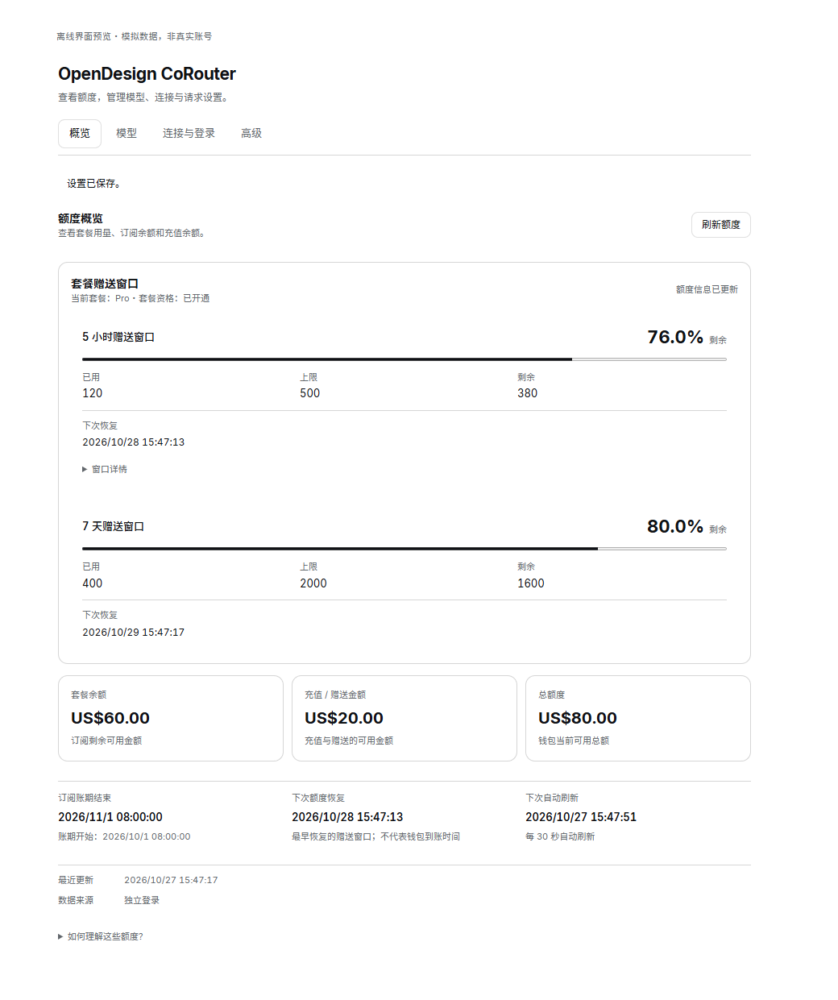
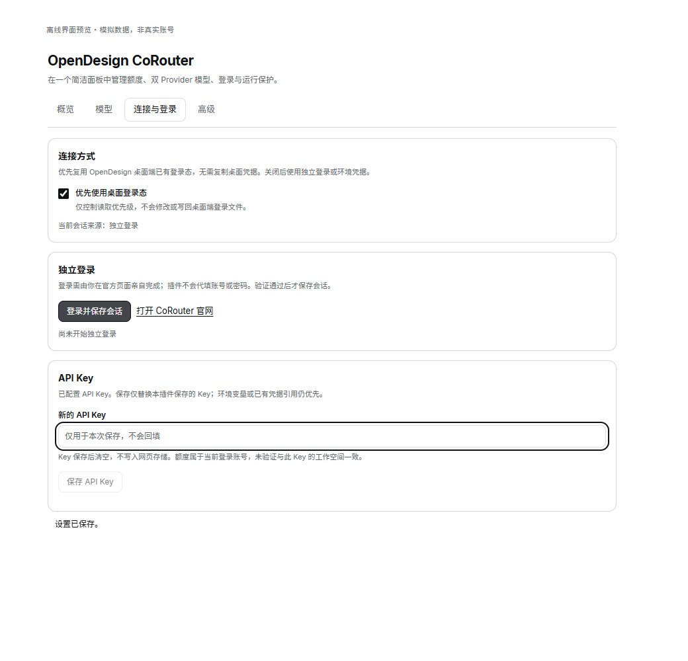

<div align="center">

# OpenDesign CoRouter for DSH

**模型接进来，额度看清楚。**

在 DeepSeek Harness 中使用 CoRouter 模型，分开查看套餐赠送窗口与钱包余额；桌面登录态优先，也能独立登录。

[](https://github.com/KouzakiUmi/dsh-opendesign-corouter/actions/workflows/ci.yml)
[](#兼容性)
[](#开发与构建)

[快速开始](#快速开始) · [功能预览](#功能预览) · [连接与凭据](docs/usage.md) · [常见问题](docs/troubleshooting.md) · [更新记录](docs/changelog.md)

<picture>
  <source media="(prefers-color-scheme: dark)" srcset="docs/previews/overview-dark.png">
  
</picture>

<sub>真实组件 · 模拟数据 · 离线预览，不是运行中的 DSH 或真实账号截图</sub>

</div>

## 快速开始

### 1. 通过 DSH 安装

```console
dsh plugin --profile web add dsh-opendesign-corouter
```

也可打开 [Actions → CI](https://github.com/KouzakiUmi/dsh-opendesign-corouter/actions/workflows/ci.yml)，从成功构建下载 **`dsh-opendesign-corouter-build`** artifact。登录 GitHub 后解压 ZIP，取得 `.tgz` 与 `.sha256`，再安装本地包：

```console
dsh plugin --profile web add /absolute/path/to/dsh-opendesign-corouter-0.1.13.tgz
```

`web` 只是示例，请替换为目标 Profile。Desktop 使用桌面安装器提供的 `dsh` 入口；独立公共 CLI 不能代管保留的 `desktop` Profile。安装后的启用与重载按目标 DSH 的管理流程进行。

### 2. 配置连接

1. 打开 **设置 → OpenDesign CoRouter → 连接与登录**。
2. 点击 **开始设备授权**，取得授权码后自动打开临时 Chrome 官方授权页，核对并确认；打开失败可用 **在新窗口打开授权页** 重试，也可复制链接到常用浏览器，或单独配置工作空间 API Key / 沿用 `COROUTER_API_KEY`。
3. 返回设置页等待保存成功。额度默认优先读取桌面登录态；要明确使用设备授权的账号，可关闭桌面优先。
4. 回到模型选择器，选择 **OpenDesign CoRouter · 套餐赠送** 或 **OpenDesign CoRouter · 付费模型**。

**设备授权同时取得查额度和官方网关推理的两类令牌；显式配置的 API Key 仍优先。** [完整连接说明](docs/usage.md)

## 功能预览

### 模型分组与默认参数

| Provider | 模型数 | 用途 |
| --- | ---: | --- |
| `opendesign-corouter-plan` | 13 | Core / Design Plan 附赠通道，含预检确认覆盖的 MiniMax M3.1 Flash |
| `opendesign-corouter-paid` | 26 | Plan 套餐模型及其他钱包付费模型 |

上表为内置目录。模型页可通过当前配置网关的 OpenAI 兼容 `/models` 接口刷新目录，逐个启用或停用模型、控制图片输入，并配置温度、top-p、默认输出上限、上下文预算及思考深度。高级参数默认折叠，图片输入可手动覆盖或恢复自动。未知模态保持未知并尝试发送图片；实际支持情况由网关决定。[图片能力证据](docs/model-capabilities.md)。

推理协议可选 **OpenAI Chat Completions、OpenAI Responses、Anthropic Messages**。模型发现始终使用当前网关的 OpenAI 兼容 `/models` 接口，不随推理协议切换。

思考档位按精确型号的厂商文档维护，并按当前协议筛选。34 款提供离散档位，4 款为固定思考或开关/预算控制，Muse Wonder 的精确别名尚待确认。旧配置中的无效默认档位可在参数设置中改为“继承默认”。[逐模型来源与网关验证状态](docs/reasoning-evidence.md)

> **分组不等于计费隔离。** 赠送额度耗尽后是否转扣套餐余额或钱包，由服务端和账号权益决定。选择“套餐赠送”不能保证绝不消耗钱包余额。

### 四层额度，不重复相加

- **套餐赠送窗口**：各自显示已用、剩余及重置时间。
- **套餐余额**：订阅池的可用金额。
- **充值 / 赠送金额**：钱包中对应池的可用金额。
- **总额度**：接口报告的总余额，不再与分池数字重复相加。

接口缺失或权限不足时显示未知 / 部分可用，不补成 0。窗口重置、订阅账期结束和下次自动刷新分别显示。桌面通道只有部分额度且已有完整独立会话时，会整体切换到独立会话并标明来源，不拼接账号数据。额度身份与推理 Key 的账号 / 工作区仍需保持一致。

### 桌面优先，也能独立登录

点击“开始设备授权”后，插件在临时 Chrome 窗口打开官方授权页。也可用“复制授权链接”在常用浏览器完成确认；复制不可用时会显示可选取的链接。确认后自动保存授权，取消或到期时结束等待并关闭临时窗口。

<picture>
  <source media="(prefers-color-scheme: dark)" srcset="docs/previews/theme-dark.png">
  
</picture>

### DeepSeek V4.1 Flash 异常结束检测

独立开关，默认开启。参考 [dsh-empty-turn-guard](https://github.com/FYTXY/dsh-empty-turn-guard)，在工具对话中将“stop 且没有工具调用、回答为空或只剩协议残渣”以及短操作前言、简短进度后说明下一步但没有工具调用的情况标成异常 EOT。文字识别属于启发式判断，可能漏检或误判。

检测到异常 EOT 后，在同一 Agent 步骤内持续重试，直到成功或取消，**没有次数上限，重复请求可能额外消耗额度**。其他错误仍遵循 DSH 的原有重试策略。附加监控仅用于 DeepSeek V4.1 Flash 的工具对话；未收到流终态且工具调用尚未开始时，按可重试的传输中断处理。

## 使用前先知道

- **额度数据**：来自官方服务及桌面端，部分接口可能随上游变化；实际扣款以控制台和账单为准。
- **凭据存储**：API Key 和设备授权由 DSH 凭据服务保存，落盘保护取决于宿主与本机权限，详见[安全说明](SECURITY.md)。
- **验证状态**：已完成真实设备授权、模型目录读取和逐模型计费预检，以及类型、隔离加载、离线界面与主题检查。真实推理和已安装 Profile 的完整联调仍待验证。

## 兼容性

| 项目 | 要求 / 证据 |
| --- | --- |
| 目标 DSH Core | `0.2.1-rc.3`，以官方同版本发布包验证 |
| Core 声明范围 | `>=0.2.1-rc.3 <0.3.0-0`，范围内其他版本不代表已实测 |
| Node.js | `>=24.9.0` |
| 独立登录 | 自动打开需本机 Chrome；也可复制链接到常用浏览器确认 |
| 默认推理接口 | `https://amr-link.open-design.ai/v1/chat/completions` |

CI 在 Windows 与 Ubuntu 执行构建、类型检查及隔离测试；Ubuntu 另执行四页签浏览器和亮暗主题检查。[开发与验证范围](docs/development.md)

## 开发与构建

```console
git clone https://github.com/KouzakiUmi/dsh-opendesign-corouter.git
cd dsh-opendesign-corouter
npm ci --ignore-scripts
npm run check
npm run test:ui
```

本地 UI 测试需要 Chrome，页面使用模拟数据并阻断联网。源码 checkout 不包含预构建 `lib`；需要安装本地目录时，先运行构建。[开发与 CI](docs/development.md)

## 文档与反馈

[使用指南](docs/usage.md) · [排障](docs/troubleshooting.md) · [更新记录](docs/changelog.md) · [安全边界](SECURITY.md) · [第三方声明](THIRD_PARTY_NOTICES.md)

通过 [Issues](https://github.com/KouzakiUmi/dsh-opendesign-corouter/issues) 反馈时，请附插件版本、DSH **Core** 版本和已脱敏的错误说明。不要贴 API Key、Cookie、凭据文件或含秘密的 URL。

本项目采用 [MIT 许可](LICENSE)，上游版权声明见 [第三方声明](THIRD_PARTY_NOTICES.md)。版本标签通过 GitHub OIDC trusted publishing 发布到 npm，流程见 [发布说明](docs/publishing.md)。本项目与 OpenDesign、DeepSeek 无官方隶属关系。
